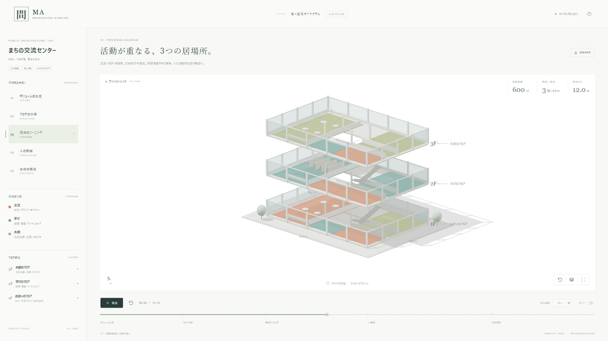

# 間 / MA — 動く建築ダイヤグラム

Three.js + GSAP + Viteで制作した、建築コンペ・プロポーザル向けのインタラクティブな3Dダイヤグラムです。白模型の構造、用途の重なり、人の流れを、日本語UIと48秒の時間軸で読み解けます。



## はじめる

配布ZIPにはビルド済みの `dist/` を同梱しています。**Windowsでは `start-preview.cmd` をダブルクリックし、`http://127.0.0.1:4173/` を開くと、そのまま操作できます。** Node.jsが必要です。このPCではCodexの同梱Node.jsも検出します。ソースを編集した後は下記手順で再ビルドしてください。

どのOSでも `node scripts/serve.mjs` でビルド済みデータを起動できます。停止はCtrl+C。ポートを変える場合は `node scripts/serve.mjs 4174` です。GitHubでは `dist/` を除外するため、クローン後にはビルドが必要です。

Node.js 22.13以上とpnpm 11.25.0を使用します。ソース一式をダウンロードして、このREADMEがあるフォルダーで実行してください。

```sh
corepack enable
pnpm install --frozen-lockfile
pnpm dev
```

表示された `http://127.0.0.1:5173/` をブラウザで開きます。初期表示は「03 用途のゾーニング」の22秒地点で停止しています。再生ボタンの横のリセットボタンを押すと、最初から全体を再生します。

Corepackが含まれないNode.js環境では `npm install --global pnpm@11.25.0` を実行してください。npmでの利用も可能です（`npm install` → `npm run dev`）。再現性を保つため、リポジトリの標準ロックファイルは `pnpm-lock.yaml` としています。

```sh
pnpm test       # シーク・5段階の状態・寸法変更を検証
pnpm build      # dist/ に本番用静的ファイルを生成
pnpm preview    # 本番ビルドを http://127.0.0.1:4173/ で確認
```

ビルド後もHTTPサーバーで開いてください。`index.html` の直接ダブルクリック（file://）ではES Modulesを読み込めません。サンプル実行時に外部API、CDN、外部フォント、有料サービスへのアクセスはありません。初回のライブラリインストールにはネット接続が必要です。

## 操作

|操作|方法|
|---|---|
|再生・一時停止|再生ボタン / Space|
|最初から再生|再生ボタンの右のリセット|
|場面を切り替え|左のステップ / 下部の場面名 / 数字1〜5|
|任意時刻へ移動|シークバー。小さな目盛りは各段階の開始位置|
|1秒ずつ移動|← / →（シークバーにフォーカス中は0.01秒単位）|
|再生速度|0.5 / 0.75 / 1.0 / 1.5 / 2.0倍|
|繰り返し|ループをオン|
|模型を回転|左ドラッグ / 1本指ドラッグ|
|ズーム|ホイール / ピンチ|
|平行移動|右ドラッグ / 2本指ドラッグ|
|カメラ初期化|右下のリセット / R|
|図示の表示・非表示|レイヤーボタン / D。用途色・動線・寸法線・フロア注釈を切替|
|全画面|全画面ボタン / F。解除はEsc|
|静止画保存|「画像を保存」で2560×1440 PNGをダウンロード|
|操作ガイド|右上の「?」|

ステップを選ぶと、構成が読みやすい時刻へ移動して停止します。再生するとそこから続きます。タブを離れると自動停止し、戻ると再生状態を復元します。全画面はブラウザが許可する環境で動作します。アプリ内ブラウザなどで全画面が制限されている場合は、ヘッダーとサイドバーを隠す集中表示へ切り替わります。もう一度ボタンを押すかEscで解除します。

PNGには現在の模型・用途色・動線・フロア注釈と、日本語タイトル・凡例を配置します。画面の操作パネルは入りません。画像のモデルサイズは保存時のウィンドウの縦横比とカメラのズームに連動します。2560×1440画面で構図を整えて保存すると、コンペ資料へ配置しやすくなります。

## 5つのアニメーション

|時間|場面|表現|
|---|---|---|
|0〜8秒|ボリュームの生成|地面から白模型がゆっくり立ち上がる|
|8〜16秒|フロアの分解|階ごとに垂直分解。屋根を上げながらフェード|
|16〜26秒|用途のゾーニング|交流＝テラコッタ、学び＝青緑、共創＝オリーブ|
|26〜38秒|人の動線|各階の回遊曲線と上下階の接続、移動する光の粒|
|38〜48秒|全体の構成|色と動線が消え、床と屋根が元の位置へ戻る|

時間軸はGSAP Timelineで制御します。粒子の位置も絶対時刻から計算するため、逆方向のシークでも同じ状態を再現します。再生は自動開始しません。

## サンプルの建築

- 30m × 20m、投影外形600㎡、3階建て、階高4m、高さ12m
- 中央に8m × 6mの吹き抜け。床リングは各階552㎡（概念値）
- 床厚260mm、柱320mm。床・壁・柱・折返し階段・半透明のガラスを別のオブジェクトで構成
- 1F：カフェ・交流ラウンジ・総合案内
- 2F：図書・閲覧・ワークショップ
- 3F：市民活動・会議・スタジオ
- 正投影カメラ、白背景、柔らかい影、控えめな模型家具と植栽

設計意図を可視化する概念模型です。床面積は階段等を含む法定面積計算ではなく、矩形と吹き抜けから求めた幾何学値です。

## 寸法・色・座標を変える

`src/config.js` を編集します。座標の単位はメートル、Xが東西、Yが高さ、Zが南北です。

```js
building: {
  width: 30,
  depth: 20,
  floorHeight: 4,
  floorCount: 3,
  slabThickness: 0.26,
  columnSize: 0.32,
  atrium: { width: 8, depth: 6 },
  origin: [0, 0, 0],
  explodedGap: 5.5,
  modelUrl: null,
}
```

ゾーンの `x / z / w / d` は建物幅・奥行に対する比率です。`palette` で3色、`floors` で階名・用途・ゾーン、`camera` で視点・画角・描画解像度上限を変更できます。階数を変える場合は `floors` の件数も合わせ、カメラの `target / viewHeight` を調整してください。変更後はプレビューを更新し、`pnpm test` と `pnpm build` を実行します。

## GLBへ置き換える

GLTFLoaderを必要時だけ読み込むアダプターを実装しています。`public/models/building.glb` にGLBを置き、`modelUrl: 'models/building.glb'` とします。GitHub Pagesのサブディレクトリでもベースパスを解決します。

GLBのシーン直下を次の名前で構成してください。

```text
Scene
├── Floor_1
│   ├── 床・柱・壁・階段・家具など
│   ├── Glass_facade_1（任意）
│   └── Zone_lounge（任意）
├── Floor_2
├── Floor_3
└── Roof
```

- 各階グループの原点はその階の床下端。各階は**ローカルY=0**を基準にモデリングしてください。全階を既に高さ付きでまとめたGLBは、そのままでは二重の高さ補正になります。
- `Roof` もローカルY=0が屋根下端。高さはアプリが設定します。
- 単位はメートル、Y-up、各階グループのscale=1 / rotation=0。外形・階高・原点は設定に一致させます。
- `Zone_` で始まるメッシュは用途色を持たせた薄い面とします。アプリが不透明度を制御します。未設定の場合は用途の着色は出ません。
- `Glass_` で始まるメッシュは、GLB側で半透明マテリアルを設定してください。
- 動線と寸法注釈はサンプルの設定形状から生成します。実施設の動線には `src/scene/diagrams.js` の制御点を調整してください。
- 階や屋根の名前・親子関係が合わないGLBは日本語のエラーを表示します。ソースは削除・上書きしません。

名前・座標が異なる既存モデルは `src/model/adapter.js` を変更し、共通契約 `{ root, floors, roof, zones, envelopes, roofMaterials, dispose }` を返すようにします。アニメーション側はモデル生成の詳細に依存しません。実際のGLBが未提供のため、完成版の実機確認は生成サンプルモデルで実施しています。

## ソース構成

```text
src/
  config.js                 寸法・高さ・階構成・色・ステップ
  model/building.js         手続き的な白模型の生成
  model/adapter.js          GLBの読込と共通モデル契約
  animation/timeline.js     GSAP時間軸とモデルへの状態適用
  scene/viewer.js           カメラ・光・影・3D操作・サイズ更新
  scene/diagrams.js         寸法線・曲線・矢印・粒子
  ui/layout.js              日本語UI
  ui/icons.js               ローカルSVGアイコン
  main.js                   UI接続・再生制御・PNG保存
  style.css                 レスポンシブレイアウト
tests/animation.test.js     時刻再現性・状態・寸法変更の検証
.github/workflows/pages.yml GitHub Pages用のCI
scripts/serve.mjs           ビルド済みデータのローカルHTTPサーバー
start-preview.cmd          Windowsでのプレビュー起動
```

共有ジオメトリ・共有マテリアル、描画ピクセル比上限、停止時の描画省略、形状変化時のみのシャドウ更新を採用しています。GLBローダーは遅延読込、Three.jsとGSAPは別バンドルです。実際の描画速度はGPUと、差し替えモデルのポリゴン・透明素材の量に依存します。

## GitHubへアップロード

**このフォルダーの中身をリポジトリのルートに置きます。** `node_modules` はアップロードしません。

```sh
git init
git add .
git commit -m "Add architectural diagram app"
git branch -M main
git remote add origin https://github.com/YOUR_NAME/YOUR_REPOSITORY.git
git push -u origin main
```

GitHubの空リポジトリを作成してから、例のURLを実際のURLへ置き換えてください。GitHubへの送信はこの制作では実行していません。

GitHub Pagesで公開する場合は、リポジトリの **Settings → Pages → Build and deployment → Source: GitHub Actions** を選びます。`main` へのpushでテスト・ビルド・公開が実行されます。Pagesの利用可否はリポジトリの公開範囲とGitHubの契約に従います。Viteは `base: './'` 設定なので、リポジトリ名に依存しません。

## プレビュー接続が失敗したとき

1. サーバーを実行した端末が開いているか確認します。
2. `pnpm dev` のLocal URLへ接続します。別ホストの127.0.0.1はこのPCに接続しません。
3. 5173が使用中なら `pnpm dev --port 5174` として表示されたURLへ接続します。
4. WebGLやハードウェアアクセラレーションの状態を確認します。
5. GLBの場合はURL、404、ファイル名、上記のグループ契約を確認します。

接続不良を理由に制作ソースを削除したり初期化する必要はありません。

## 検証・ライセンス

本番ビルドと3件のNode.jsテスト、2560×1440のブラウザ表示、5場面、再生・一時停止、速度・シーク・図示切替、回転・ズーム・視点リセット、全画面、PNG出力を検証しています。

アプリのオリジナルコードはMIT License。Three.jsはMIT、GSAPは独自のStandard Licenseです。GSAPをMITとして再配布するものではありません。ライブラリの権利表記は `THIRD_PARTY_NOTICES.md` を確認してください。

参考：[Three.js公式ドキュメント](https://threejs.org/docs/)、[GSAP Timeline](https://gsap.com/docs/v3/GSAP/Timeline/)、[Vite静的配信](https://vite.dev/guide/static-deploy.html)。
